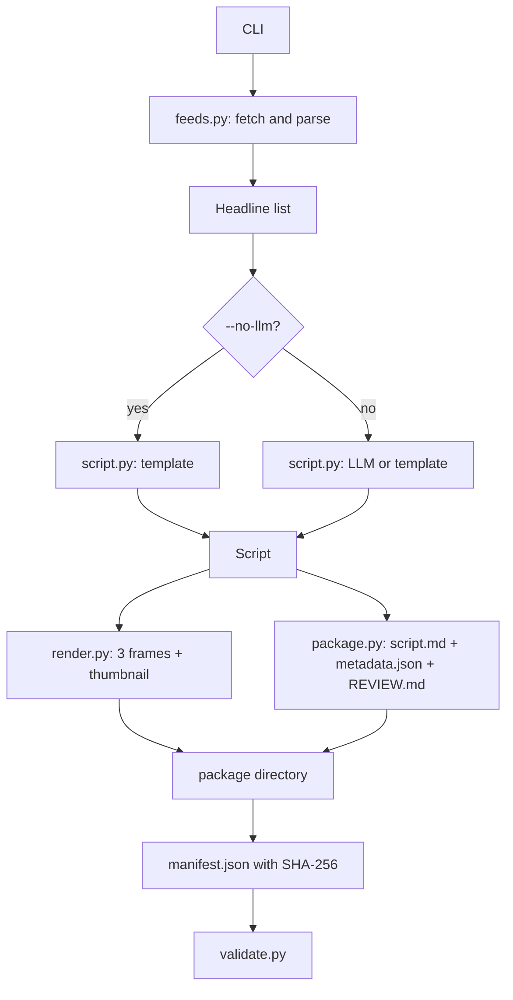

# Architecture

## Scope

The architecture is a local, single-process Python pipeline that writes a portable
package directory. It has no database, no server, and no YouTube API integration in
v0.1. The package format is the integration boundary for future renderers and manual
uploads.

## Normative Statements (RFC 2119)

- The system MUST be a local CLI process with no resident server in v0.1.
- The feed ingestor MUST accept HTTP(S) URLs and local file paths.
- The script engine MUST use only the headline and summary as factual source material.
- The renderer MUST produce escaped SVG and MUST NOT embed script or remote content.
- The package writer MUST write only inside the requested output directory.
- The validator MUST reject absolute paths, parent traversal, and checksum mismatches.
- The system MUST NOT require a database or a cloud service for the default path.
- The system MAY call an OpenAI-compatible endpoint when explicitly configured.
- The system SHOULD remain compatible with Python 3.11 through 3.13.

## Components and boundaries

| Component | Module | Compute class | Storage class | Network class |
| --- | --- | --- | --- | --- |
| CLI | `cli.py` | Local process | None | None (delegates) |
| Feed ingestor | `feeds.py` | Local process | None | Outbound HTTPS or local file read |
| Script engine | `script.py` | Local process | None | Optional outbound HTTPS to LLM |
| SVG renderer | `render.py` | Local process | None | None |
| Package writer | `package.py` | Local process | Local filesystem | None |
| Validator | `validate.py` | Local process | Local filesystem | None |

## Data flow

## Package boundary

The package directory contains exactly the required artifacts plus `manifest.json`:

| Artifact | Type | Purpose |
| --- | --- | --- |
| `frame-01-hook.svg` | 1080×1920 SVG | First three seconds |
| `frame-02-context.svg` | 1080×1920 SVG | The factual beat |
| `frame-03-punchline.svg` | 1080×1920 SVG | Final reaction and CTA |
| `thumbnail.svg` | 1280×720 SVG | YouTube thumbnail |
| `script.md` | Markdown | Three-beat script and production notes |
| `metadata.json` | JSON | Title, description, tags, privacy |
| `REVIEW.md` | Markdown | Human review checklist |
| `manifest.json` | JSON | Provenance, schema, file checksums |

## Deployment topology

- **Developer workstation:** `pip install -e .` then `newsmemeai-youtube build`.
- **CI runner:** Ubuntu, Python 3.11–3.13, ruff + mypy + pytest + spec audit.
- **Future automation:** a scheduled job MAY run the CLI and commit packages to an
  artifact store, but the upload step MUST remain human-gated.

## Why not AESEv2 or OSMv6

- **AESEv2** targets an Astro application on Cloudflare Workers/Pages. This product is a
  Python CLI that writes local files; there is no edge web application to synthesize.
- **OSMv6** targets ambiguous intent routing with a synonym graph and external fallback
  callbacks. This pipeline has a fixed three-stage flow and no user-intent classifier.

Both skills remain available for a future web front end or a multi-channel routing
service. They are not architectural dependencies of v0.1.

## Open Questions

- Should a future renderer consume the package and produce MP4, or should the package
  stay a storyboard-only artifact?
- Is a signed manifest necessary before a manual upload workflow exists?

## Change Log

| Date | Author | RFC 2119 level changed | Rationale |
| --- | --- | --- | --- |
| 2026-11-16 | Pilot | Initial | Local CLI, package boundary, and N/A rationale for AESEv2/OSMv6. |
